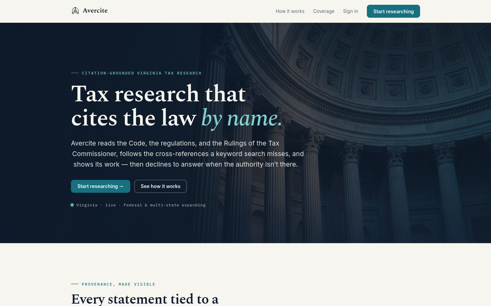
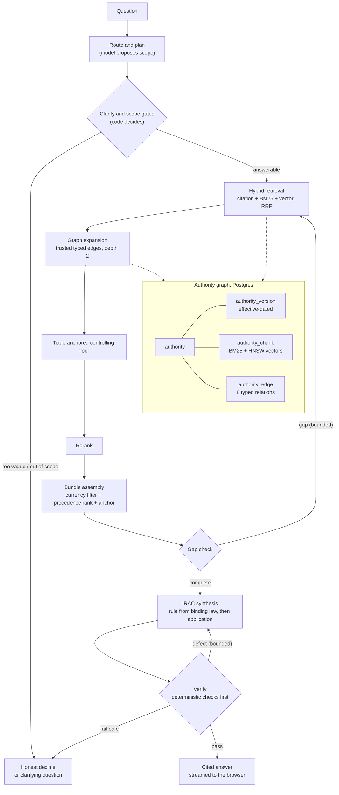
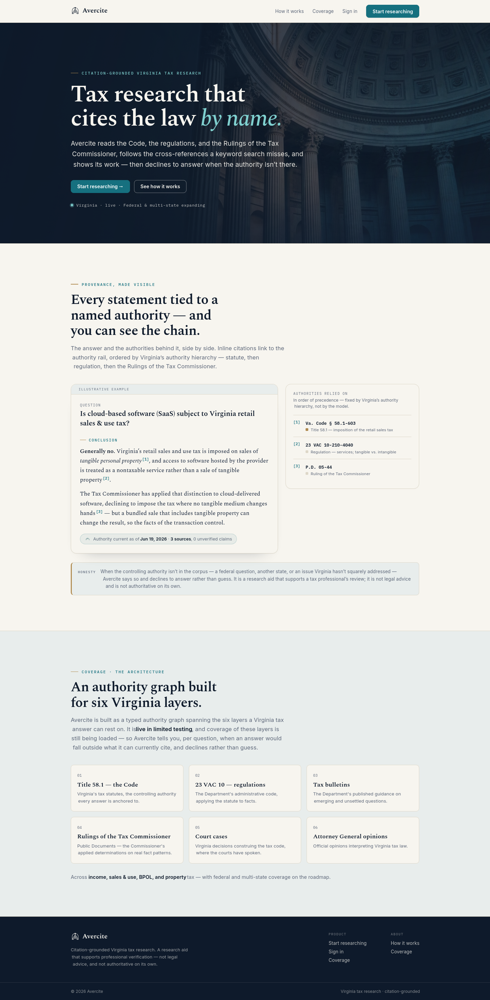
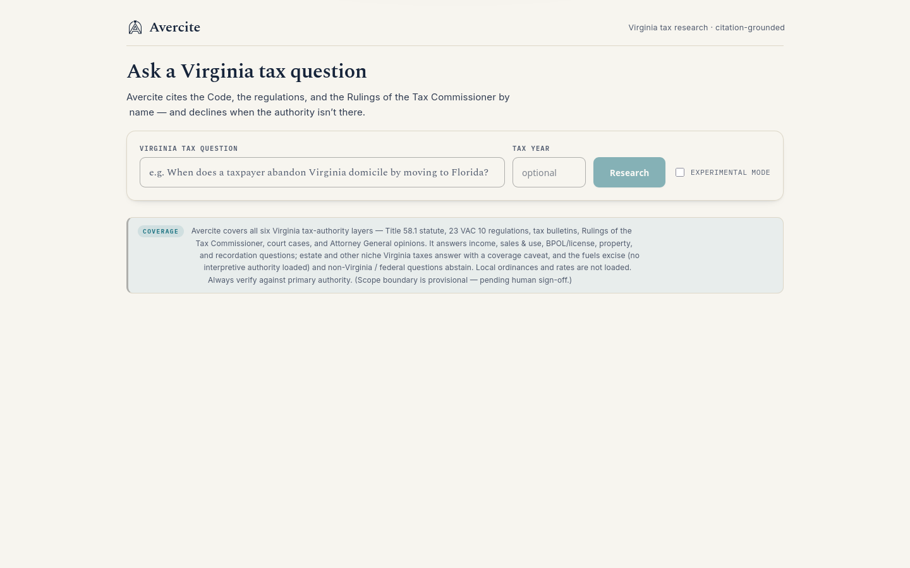

# Avercite

**Virginia tax research that cites the law by name: a citation-grounded research agent over a typed authority graph.**

Live: [avercite.com](https://avercite.com) (sign-in is invite-only during testing)

---

## What it is

Avercite answers Virginia tax questions for tax professionals. Every statement in an answer is tied to a named authority: a section of the Code, a regulation, a Tax Commissioner ruling. When the law it would need isn't in its corpus, it says so and declines instead of guessing.

It is not "chat with your documents." The corpus is modelled as a graph of legal authorities with typed relationships. The things that decide whether a legal answer is right (which authority controls, whether it is still in force, what it cross-references, and the exact citation) are decided by deterministic code. The language model's job is narrower: explain an evidence bundle that code has already assembled, filtered and ranked.

## Highlights

- **A six-layer authority graph of Virginia tax law.** 13,599 authorities and 53,905 embedded passages across the statutes (Title 58.1), regulations (23 VAC 10), tax bulletins, Rulings of the Tax Commissioner, court cases and Attorney General opinions. They are joined by eight typed edge kinds (`cites`, `interprets`, `implements`, `amends`, `enacted_by`, `supersedes`, `overrules`, `conforms_to`), and each edge records where it came from.
- **Zero citations outside the evidence.** A deterministic verifier rejects any answer that cites an authority not in the bundle code assembled. That rate is a hard release gate, and it has held at 0 through every measured evaluation run.
- **Precedence belongs to code, and code proves it.** Authorities are ranked on a seven-band ladder (statute, binding appellate court, regulation, bulletin, ruling, persuasive court, AG opinion). All the within-band adjustments are capped so that a regulation can never outrank a statute, and the module checks that arithmetic every time it loads.
- **Retrieval that follows the law, not just the wording.** Exact-citation, BM25 and vector search are fused, then expanded along trusted graph edges. A topic index then pulls in the statutes that on-point rulings actually rely on. On an untouched holdout set this lifted controlling-authority recall from 68.4% to 75.4%.
- **Evaluated against its own corpus.** A gold set of 608 questions across 120 tax types was mined from the rulings' own citation structure, with a 20% holdout that tuning never touches. Changes ship only if they pass that harness, and several "improvements" were rolled back when it vetoed them.
- **An agentic research mode with the same guarantees.** An optional research loop lets a reasoning model work through the corpus step by step (search, open, follow citations, record issues) while code validates and executes every action. If it fails, the standard pipeline answers instead. In a 57-question paired comparison it raised judged correctness from 0.700 to 0.772.
- **A full product around the engine.** Answers stream live as the pipeline works, firms are isolated from one another at the database level, every finished query is written to a hash-chained audit log, memos export to PDF and Word, and there is a bearer-token API for programmatic callers.

## Architecture

A question goes in as a durable job. A separate worker runs the pipeline and streams each stage to the browser, so the user watches it plan, retrieve, check and verify. The model takes part in planning, gap-checking, synthesis and one part of verification. Retrieval, graph expansion, currency filtering, precedence ranking and the citation checks are pure code. Synthesis can only cite from the closed bundle. The verifier runs deterministic grounding, currency and precedence checks first, then makes one model call to ask whether each quoted passage actually supports its claim. The retry loops are capped, and when they run out the answer is an honest decline, never a weaker answer passed off as a full one.

The full walk-through is in [docs/architecture.md](docs/architecture.md).

## Engineering notes

**Model proposes, code disposes.** The same pattern runs through the whole system. The router *proposes* a tax domain and a scope gate *decides* against a measured coverage manifest. A clarify call *proposes* that a question is ambiguous and a gate refuses only when the model has named at least two competing readings, the missing facts and a clarifying question. A supersession extractor *proposes* that one ruling replaced another, and seven pure gates *dispose*: among other checks, the quoted notice must be found verbatim in the source text and the target must resolve to a real authority. Of 477 candidates, 25 status changes passed all seven gates, and the run produced nothing on a nine-item negative fixture. Every boundary that matters can be read and unit-tested apart from the model.

**Letting the metrics veto good-looking ideas.** The evaluation harness tracks controlling-recall, anchoring, claim-level grounding and false-abstention together, so a gain on one cannot hide a loss on another. Two examples. A rule that kept "remedies and appeals" sections from anchoring answers looked obviously right, but it dropped holdout anchoring from 72.3% to 64.3%, because some of those sections are genuinely substantive (officer liability, omitted-tax assessment). It was reverted. An anchor "topic guard" won on a 30-item slice and was deployed. On a larger stratified run it introduced a confidently wrong answer and pushed false-abstention from 5.0% to 8.3%, so it was rolled back the same day. For a legal tool, one confidently wrong citation outweighs a few points of average quality.

**Making statute-grounding structural.** Early answers often cited only rulings, even when the controlling statute was right there in the bundle. Synthesis was split the way a lawyer reasons: first state the *rule* using binding authorities only (that pass has no way to cite a ruling), then explain the *application* citing rulings. On the holdout set, claim-level statute grounding went from 54.4% to 73.4%, and false-abstention fell from 13.3% to 8.7%.

**A gold set the corpus writes for itself.** Each Tax Commissioner ruling already pairs a taxpayer's question with the authorities that decide it. The harness mines those pairs from the graph, keeps a statute as "controlling" only when at least three distinct rulings cite it, uses a heading classifier to exclude procedural sections, and freezes a stratified 20% holdout. A later model-panel adjudication grouped sibling statutes into 133 controlling families, so the metric would stop punishing a correct neighbouring section. The gold set is still awaiting ratification by a Virginia tax professional, and the project treats its numbers as a floor, not a final grade.

**Fitting a 4096-dimension embedding into an index.** The embedding model emits 4096 dimensions, which is over the vector index's limit. Because the model is trained so that a prefix of the vector is itself a usable embedding, vectors are cut to their first 2048 dimensions, renormalised and stored as half-precision. That keeps one HNSW index serving all 53,905 passages next to BM25 in the same Postgres instance.

## Tech stack

| Layer | Technology |
|---|---|
| App | Next.js 15 (App Router), React 19, TypeScript (strict) |
| Database | PostgreSQL 16 via ParadeDB: pgvector `halfvec` HNSW, pg_search BM25, `ltree`, range exclusion constraints |
| Data access | Raw SQL with `node-postgres` (no ORM), row-level security per firm |
| Jobs | graphile-worker (Postgres-backed): query jobs plus daily corpus-refresh crons |
| Streaming | Server-Sent Events from durable job events, with replay on reconnect |
| Models | DeepSeek V4 Flash (synthesis and judgment), Qwen3-Embedding-8B, Qwen3-Reranker-8B, a GLM reasoning model for the research loop. All via a zero-data-retention inference provider |
| Citation parsing | Deterministic regex families plus eyecite (Python) for reporter citations |
| Storage | S3-compatible object storage for raw source documents |
| Auth and billing | Better Auth magic links (Resend), Stripe subscriptions |
| Export | `@react-pdf/renderer` memo PDF, Word export |
| Testing | Vitest (unit and integration release gates), Playwright (end-to-end, UX screenshots) |

## By the numbers

| | |
|---|---|
| Commits | 241 (2026-06-16 to 2026-08-05) |
| Source lines | 44,316 |
| Tracked files | 883 |
| Test files | 65 |
| SQL migrations | 18 |
| Languages | TypeScript 88.5%, CSS 4.7%, JavaScript 4.3%, Shell 1.4% |
| Corpus | 13,599 authorities, 53,905 embedded passages, 6 layers |

**Measured results.** These come from the project's own harness. Correctness scores are from an LLM judge panel and are advisory; the out-of-bundle citation check is deterministic.

| Holdout set (n=105, never tuned on) | Before | After graph-native retrieval + IRAC |
|---|---|---|
| Controlling-recall@20 | 68.4% | **75.4%** |
| Controlling authority in bundle | 74.3% | **79.8%** |
| Answer cites the controlling authority (when in bundle) | 62.8% | **72.3%** |
| Claim-level statute grounding | 54.4% | **73.4%** |
| False abstention | 13.3% | **8.7%** |
| Citations outside the evidence bundle | 0 | **0** |

| Research loop, paired 57-question panel | Standard pipeline | Research loop |
|---|---|---|
| Judged correctness (0 to 1) | 0.700 | **0.772** |
| Controlling-recall@20 | 70.2% | **82.2%** |
| Controlling authority in bundle | 84.2% | **94.7%** |
| Confidently wrong answers | 7 / 56 | 6 / 55 |
| Citations outside the evidence bundle | 0 | **0** |

## Screenshots

**Home page (full length)**

**Research workspace: ask a Virginia tax question**

## About this repo

Avercite's source code is private. This repository documents what was built and how it works, and contains no source code from the product.

Built by [Emergent AI Agency](https://emergentaiagency.com) (Ryan Chappell). Avercite is Emergent's own product, and the same approach (code owns the facts, the model explains them, and a measured harness decides what ships) carries over to client work in any field where a wrong answer is costly. To talk about a project, get in touch through [emergentaiagency.com](https://emergentaiagency.com).

*Avercite is a research aid that supports a tax professional's own review. It is not legal advice.*
