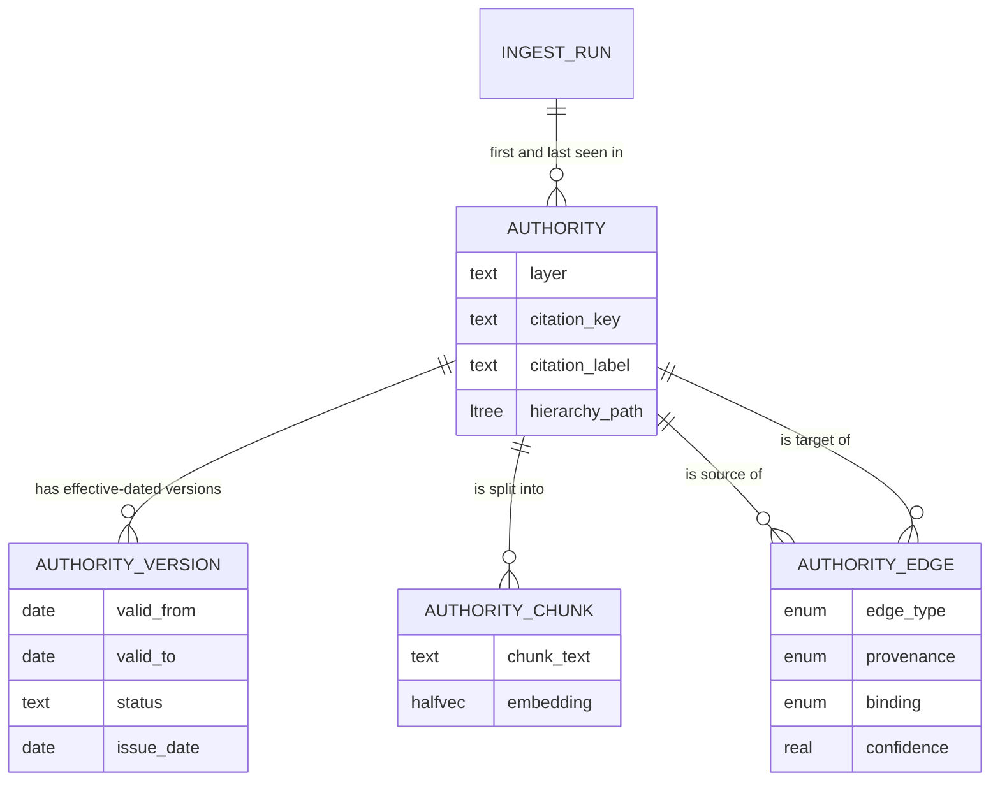
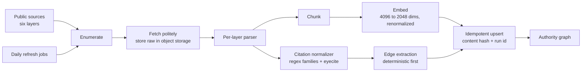
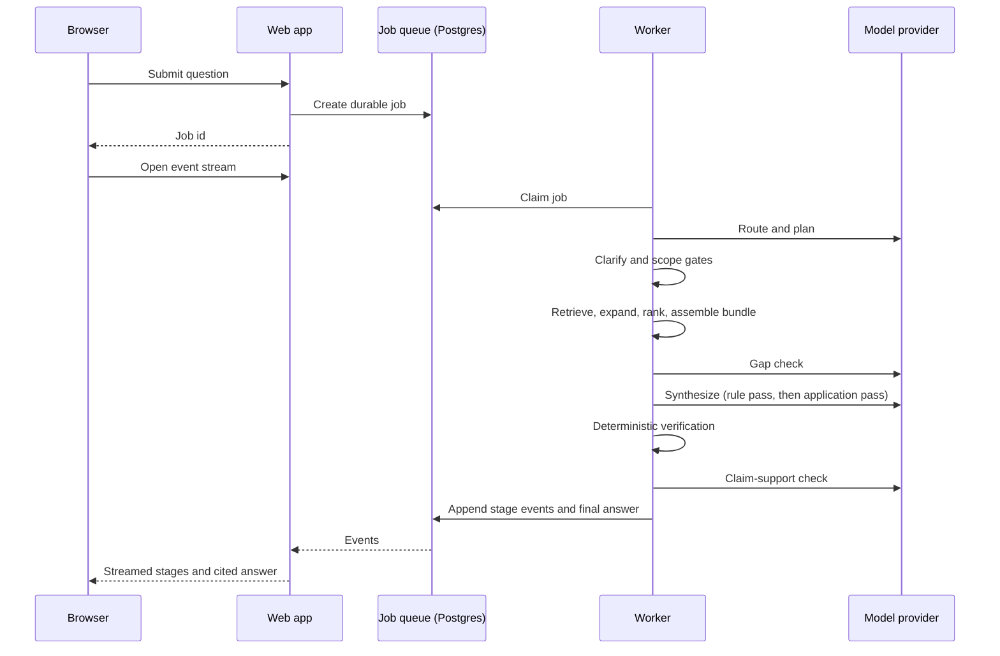
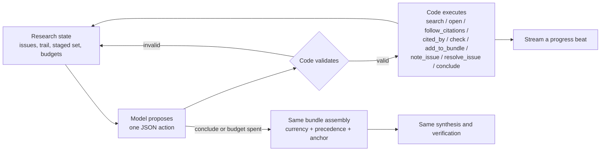
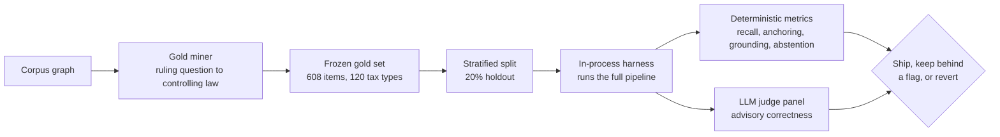

# Avercite: architecture

This document goes one level deeper than the [README](../README.md): how the corpus is modelled, how a question becomes a cited answer, how quality is measured, and why the main decisions were made. Snippets are illustrative shapes rewritten for this page, not product code.

## Design principle

A correct answer to a tax question turns on four things: **which authority controls**, **whether it was in force for the year in question**, **what it cross-references**, and **the exact citation**. In Avercite all four are owned by deterministic code. The model never ranks authorities, never decides whether a document is current, and can only cite authorities that code placed in a closed evidence bundle. Its job is to explain that bundle in plain language.

The same split, *model proposes, code disposes*, applies wherever a judgment has to become a decision: scope, ambiguity, supersession, and the actions of the agentic research loop.

## 1. The authority graph



**Nodes** are authorities from six layers:

| Layer | Authorities |
|---|---|
| Statutes (Code of Virginia, Title 58.1) | 1,793 |
| Regulations (23 VAC 10) | 654 |
| Tax bulletins | 498 |
| Rulings of the Tax Commissioner | 9,650 |
| Court cases (Supreme Court and Court of Appeals of Virginia) | 246 |
| Attorney General opinions | 758 |
| **Total** | **13,599** (53,905 passages, all embedded) |

Each authority has a normalized `citation_key` (for example `vacode:58.1-602`, `vareg:23VAC10-210-4040`, `pd:05-44`), so an exact citation in a question becomes an exact lookup.

**Identity is separate from text over time.** `authority` is the stable identity. `authority_version` holds effective-dated text with a database exclusion constraint, so no two versions of one authority can claim overlapping date ranges. Records are never hard-deleted; ingestion closes an effective window or changes a status instead.

**Edges are typed and only stored in one direction.** There are eight forward relation types: `cites`, `interprets`, `implements`, `amends`, `enacted_by`, `supersedes`, `overrules`, `conforms_to`. Inverses ("superseded by") are derived by querying the target side, so there are no reverse edges to keep in sync. Every edge records its **provenance**: a structured field in the source, a deterministic regex, a bulk court-citation dataset, the "Related Documents" list each ruling publishes, model inference, or manual entry. Model-inferred edges also carry a confidence. A citation that doesn't resolve yet is kept as a dangling key and bound later when its target arrives.

**Search lives next to the graph.** Each passage carries a BM25 index and an HNSW vector index inside the same Postgres instance, so exact-citation, lexical and semantic retrieval, plus graph traversal, all happen in one database with no separate search service to keep in sync.

## 2. Ingestion



- **Per-layer parsers and chunkers** for statutes, regulations, bulletins, rulings, court cases and AG opinions, each with its own unit tests.
- **Idempotent by construction.** Every stage keys on a content hash and records the ingest run that first and last saw each authority. Re-running a stage on unchanged input is a no-op.
- **Citations are normalized deterministically and offline.** Regex families cover Virginia and federal citation forms (statute, regulation, bulletin, ruling, IRC, Public Law, U.S. Code). Reporter citations for court cases go through eyecite. Anything unrecognized comes back as `unknown`, never as a guess.
- **Edges are deterministic first.** Most edges come from structure that already exists in the sources: a regulation's statutory-authority field, each ruling's published Related Documents list, in-body citations, and a public court-citation dataset. Model inference is kept for relations that are only implicit.
- **Issue dates are derived, never invented.** A precedence ladder (effective-date copy, then a year-checked body dateline, then the year in the document number, then a coarse fallback) dated all 11,207 in-scope rulings, bulletins and AG opinions. 11,171 resolved to an exact day and 36 to a year only.
- **Freshness.** Two daily scheduled worker jobs re-check the ruling layer and the other five layers for new or changed documents.

## 3. Answering a question



Each query is a **durable job** run by a **separate worker process**. Stage events are written to Postgres and streamed to the browser over Server-Sent Events, so a dropped connection can replay from the stored events and a reopened answer comes back exactly as it was produced.

### 3.1 Gates before any retrieval spend

- **Clarify gate.** One model call with reasoning enabled judges whether the question has several distinct readings (for example "Is labor taxable?" names neither the tax nor the kind of labor). Code refuses only when the model has named at least two readings, the missing facts and a clarifying question. Otherwise the readings become a coverage checklist for synthesis. A refusal short-circuits the whole pipeline before any retrieval cost. On a labelled set of 16 calibration traps, vague questions were sent back for clarification 4 of 4 times and specific ones were answered 5 of 5.
- **Scope gate.** The router proposes a tax domain and the kind of authority the answer turns on. Code checks that against a coverage manifest built from measured interpretive depth per domain. Where the corpus has no interpretive layer (motor-fuels excise, for example), the gate declines instead of letting the model improvise.

### 3.2 Retrieval

1. **Three arms**: exact citation lookup, BM25 over passages, and HNSW vector search.
2. **Reciprocal Rank Fusion** at authority level (k = 60, the citation arm weighted 3×), with deterministic tie-breaking so evaluation runs are reproducible.
3. **Graph expansion** from the fused seeds by a recursive walk with a cycle guard, at most two hops. It follows only *grounding* relations (`cites`, `interprets`, `implements`) and only edges with deterministic provenance or confidence of at least 0.75. Temporal relations (`supersedes`, `overrules`, `amends`) are left to the precedence code, so expansion can never quietly pull in a superseding document.
4. **Topic-anchored controlling floor.** An index maps each tax type to the operative statutes and regulations that at least three distinct rulings in that topic cite. At query time the tax type is read off the rulings actually retrieved, and that topic's controlling law is seeded directly into the candidate set. Text similarity finds the on-point rulings; the graph supplies the law they rest on.
5. **Rerank** with a cross-encoder.

### 3.3 Bundle: currency, precedence, anchor

The bundle is the closed set the model is allowed to cite. Code assembles it:

- **Currency.** Each authority is checked against the governed tax year. Superseded or repealed authorities are pushed below everything live (a fixed +1000 rank penalty) but still shown, flagged, rather than silently dropped.
- **Precedence rank**, lower meaning stronger:

  ```ts
  // illustrative
  rank = tierBase(layer, binding)   // 100 statute, 200 binding appellate court,
                                    // 300 regulation, 400 bulletin, 500 ruling,
                                    // 600 persuasive court, 700 AG opinion
       + recencyPenalty             // tiebreak only; statutes/regs exempt
       + courtSubrank
       + topicalityPenalty          // framing/procedural sections sink in-tier
       + weakVouchPenalty           // graph-reached with no surviving seed
       - relianceBonus
       + (treated ? 1000 : 0)       // superseded / overruled
  ```

  Each in-tier adjustment has a cap, and the module asserts at load time that the worst-case sum stays inside the 100-point gap between tiers. That makes "a regulation never outranks a statute" a checked property of the code, not just a convention.
- **Anchor.** One controlling authority is designated as the anchor: the statute that the largest number of independently retrieved rulings cite directly. The interface marks that single authority as controlling.
- **Federal conformity.** Virginia conforms to the Internal Revenue Code as of a fixed date set by the legislature. That date comes from a code-owned table, never from parsing statute text. Years the table doesn't cover resolve to an explicit "conformity unknown", and the verifier blocks any claim that asserts a federal-conformity position in that state.

The prompt is laid out as a stable prefix (charter, protocol, bundle) followed by the volatile question. The bundle only ever grows by appending, so gap-check, synthesis and verification reuse the provider's prompt cache.

### 3.4 Synthesis

Synthesis is split in two, the way a legal memo is written (IRAC):

1. **Rule.** State the governing rule using binding authorities only. This pass cannot cite a ruling at all, so statute grounding is built in.
2. **Application.** Apply the rule to the facts and cite rulings, bulletins and opinions as support.

Code puts the rule first. If there is no anchor, or the rule pass abstains, the pipeline falls back to a single-pass synthesis, so this split can never cause a new abstention. Output is strict JSON with claims and per-claim citation keys.

### 3.5 Verification

Verification runs cheapest and strictest first:

1. **Grounding (hard gate).** Every cited key must be in the bundle. A citation outside it is treated as a hallucination and sends the answer back for re-synthesis against the same bundle. This rate has held at zero across the project's recorded evaluation runs and is a release gate.
2. **Uncited statute text.** A claim that recites "§ 58.1-…" in prose without citing that section is flagged.
3. **Currency and conformity.** Claims can't rest on authority that wasn't in force for the year in question, or assert conformity where it is unknown.
4. **Claim support.** One batched model call asks whether each claim's cited passages actually support it. Any error or unparseable result counts as a failure, never a pass.

The outcomes are `pass`, `resynthesize` (a defect), `reretrieve` (a gap) or `abstain`. Each loop is capped at two rounds. When they run out the result is an explicit decline or a clearly caveated answer, and the zero-out-of-bundle rule is never relaxed to get there.

## 4. Agentic research mode

The fixed pipeline answers one framing of a question in a single retrieval pass. The research loop, an opt-in "Experimental Mode", lets a reasoning model work the corpus over many steps:



- **The same guarantees as the fixed pipeline.** Citation-walking tools use the same edge-trust gate as graph expansion. Anything the model stages goes through the same currency, precedence and anchor code. Synthesis and verification are unchanged.
- **Hard budgets** on steps, document opens, searches and wall-clock time, plus a closing phase that code forces near the end. If the model faults twice it is moved into that closing phase; any loop failure falls back to the fixed pipeline, never to a failed run.
- **Built for caching.** An append-only transcript of actions and observations kept the prompt-cache hit rate at 88%. Cost per arm fell from $0.64 to $0.43 even though prompts were 2.2× larger, at about 3.6¢ and 68 seconds per query on the 12-item benchmark.
- **Chosen by experiment.** On a frozen 12-item benchmark the fast synthesis model could not drive the loop reliably (four empty bundles), and raising reasoning effort made containment worse. The shipped setup uses a stronger reasoning model at low effort.
- **Measured before it shipped.** On a paired 57-question panel against the standard pipeline: judged correctness 0.700 → 0.772, controlling-recall@20 70.2% → 82.2%, controlling authority in bundle 84.2% → 94.7%, confidently-wrong answers not increased (7/56 → 6/55), out-of-bundle citations 0 in both.

## 5. Supersession detection

Rulings and bulletins are sometimes withdrawn or replaced, and the notice is often a line of editorial text in the newer or older document. Avercite detects these relationships with a model-proposes / code-disposes pipeline:

- The model proposes a relation (supersedes, overrules, revokes, or the inverse) along with a verbatim supporting quote.
- **Seven pure gates** decide what happens. Among them: the quote must be found in the source text (allowing for whitespace differences); the target must resolve to a corpus authority; the dates must run in the right order; there must be no scoping phrase that limits the supersession; and an independently framed second model call must agree.
- **Two tiers.** Passing all seven gates allows a status change. A partial pass (quote, target, direction and high confidence) records an informational edge only. Everything else is kept in an audit table that can be replayed, and nothing is hard-deleted.
- **Result on the full run.** 477 candidates produced 25 status changes, each backed by a verbatim notice from the Department, plus 39 `supersedes` and 3 `overrules` edges. Recall was 19 of 22 known findings, with the other 3 documented as deliberate exclusions, and the run produced zero findings on a nine-item negative fixture.

## 6. Evaluation



- **Gold items come from the corpus itself.** A ruling's headnote becomes the question. Statutes and regulations it cites become the controlling authorities, but only if at least three distinct rulings cite them and a heading classifier rules them operative rather than procedural. That yields 608 items across 120 tax types and 1,246 controlling authorities. The set is frozen, so later tuning can't quietly reshape it, and a stratified 20% (105 items) is held out.
- **An adversarial audit of the gold set.** A model acting as a sceptical CPA audited a 50-item sample of the first build. It found that a frequency-based "procedural" detector was wrongly excluding core imposition and apportionment statutes. That detector was replaced before any baseline was recorded.
- **Controlling families.** A ten-agent model panel later adjudicated 189 stratified items, grouping 273 controlling authorities into 133 families so that citing a correct sibling section isn't scored as a miss.
- **Metrics:** controlling-recall@k, MRR and nDCG for retrieval; how often the answer actually cites the controlling authority when it is in the bundle; claim-level statute grounding; out-of-bundle citation rate (the hard gate); false abstention; precedence and temporal correctness; latency. Answer correctness comes from an LLM judge panel scoring against the source ruling's holding and is treated as advisory; "unverifiable" verdicts are excluded rather than counted as passes.
- **Everything that changes behaviour sits behind a flag.** That lets each change be A/B-tested on paired items and turned off in production with a configuration change, without a rebuild.

**What the harness decided.** The graph-native retrieval and IRAC work moved holdout controlling-recall@20 from 68.4% to 75.4%, statute grounding from 54.4% to 73.4%, and false abstention from 13.3% to 8.7%. Over the same period the harness rejected a blanket rule against "remedies" sections (holdout anchoring fell from 72.3% to 64.3%), a hard drop of graph noise (it gutted thin tax types), and an anchor topic guard (it introduced a confidently wrong answer). The gold set is still waiting for ratification by a Virginia tax professional, and the project reports these numbers as a floor.

## 7. Platform

- **Tenancy.** Each firm's data is isolated by row-level security enforced in Postgres, applied to the table owner as well. The application connects as a non-privileged role, and every tenant read or write is scoped to the firm in the session. A request without a tenant context sees no rows at all.
- **Audit.** Every finished query appends to a per-firm, hash-chained audit log, so any edit to past entries breaks the chain and shows up on re-check. Model calls are logged by stage, latency, token usage and a hash of the prompt, never the prompt text.
- **Data handling for model calls.** Every off-box model call goes through one client that checks the request against a compile-time allowlist of provider, endpoints and models, and rejects any request option that would turn on retention. A release-gate test covers that check.
- **Access.** Sign-in is by magic link. Before running research, a user must accept the current version of the disclaimer, and the acceptance is logged; changing the disclaimer text requires everyone to accept again. During testing, sign-in is limited to an allowlist.
- **Product surfaces.** The streaming research view, query history (search, categories, bulk actions, trash with restore), research memo export to PDF and Word with firm branding, Stripe subscriptions, and a bearer-token API (`POST /api/v1/query`, authority lookup, and a deterministic authority search with keyset pagination) for programmatic callers.
- **Release gates.** Unit and integration tests cover the egress check, tenant isolation, the grounding gate, the precedence invariant, the UX honesty rules (abstention, coverage and disclaimer copy), and a palette test that fails on any colour outside the brand kit.

## 8. Decisions worth noting

| Decision | Why |
|---|---|
| Typed graph rather than plain document retrieval | Controlling statutes often don't share wording with the question; the rulings that interpret them do. The graph is what makes the statute retrievable. |
| One Postgres for graph, BM25 and vectors | Hybrid retrieval and recursive graph walks in one transactional store, with no index synchronisation. |
| No ORM; raw SQL | Recursive CTEs, BM25 operators, vector operators and RLS session settings are central, and an ORM would hide them. |
| Embeddings cut to 2048 dimensions | The model's prefix-trained vectors keep quality while fitting the HNSW dimension limit in half precision. |
| A fast, inexpensive model for most language steps | Early testing showed no hallucinated citations and correct abstention on a trap question with reasoning turned off. Quality comes from what code puts in the bundle, not from model size. |
| Dated model pin | The production model is pinned to a dated snapshot so the provider can't change it silently. The previous alias stays allow-listed as a one-line rollback. |
| Decline over guess | For professional users a confident wrong citation is the worst outcome. False abstention is tracked as a metric that can veto changes, so caution doesn't become uselessness either. |
